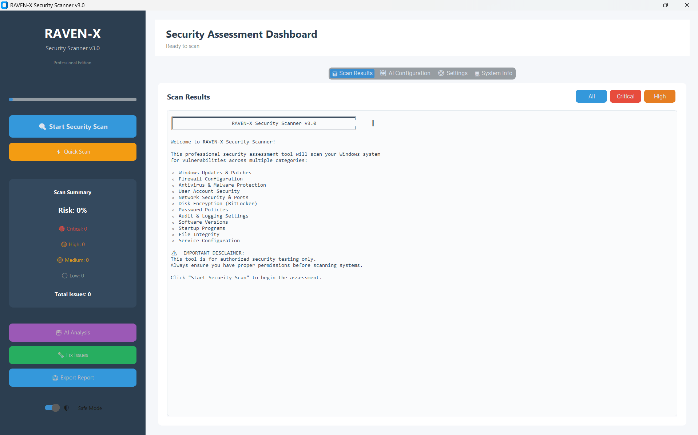
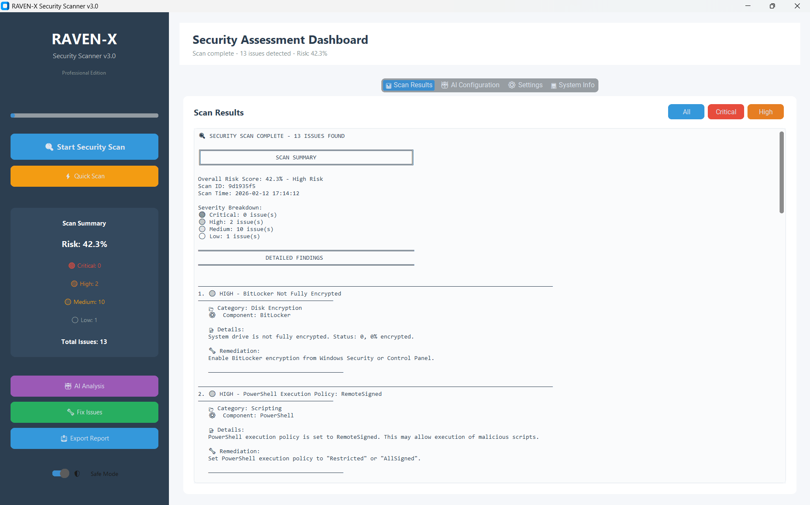
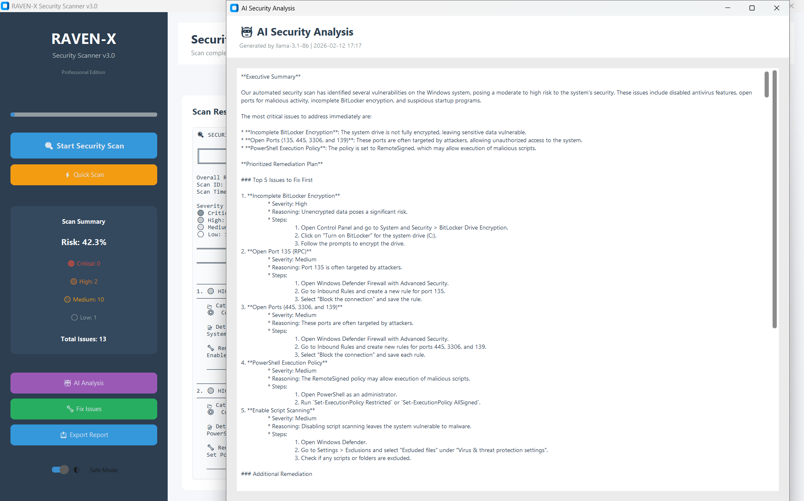

# 🔒 RAVEN-X Enterprise Security Platform v4.0

> **AI-Powered Windows Vulnerability Scanner & Auto-Remediation Engine**

[](https://www.python.org/)
[](https://fastapi.tiangolo.com/)
[]()

---

## 🚀 What is RAVEN-X?

RAVEN-X is a **next-generation security platform** that combines:

- ✅ **Comprehensive Vulnerability Scanning** - 20+ security modules
- 🤖 **AI-Powered Threat Detection** - ML-based malware detection & zero-day heuristics
- 🔧 **Automated Remediation** - One-click security fixes
- 📊 **Professional Reporting** - HTML, PDF, JSON, CSV, DOCX
- 👁️ **Real-time Behavioral Monitoring** - Detect attacks as they happen
- 🧠 **Self-Learning Engine** - Gets smarter with every scan

---

## 🎯 Features

### 🔍 Advanced Scanning
- Windows Updates & Patches
- Firewall Configuration
- Antivirus Status
- User Account Control (UAC)
- Remote Desktop Security
- Network Ports & Services
- BitLocker Encryption
- Password Policies
- PowerShell Execution Policy
- SMB Protocol Vulnerabilities
- Registry Analysis
- Memory-based Threats
- Rootkit Detection
- Privilege Escalation Vectors
- **...and 10+ more!**

### 🤖 AI & Machine Learning
- **Local LLM Integration** (LM Studio)
- ML-based malware classification
- Anomaly detection
- Pattern learning from scans
- User feedback learning
- Zero-day heuristics

### 🔧 Auto-Remediation
- One-click vulnerability fixes
- System restore point creation
- Safe mode with rollback
- PowerShell script generation
- Detailed execution logs

### 📊 Reporting
- **HTML** - Beautiful interactive reports
- **PDF** - Executive summaries
- **JSON** - Machine-readable data
- **CSV** - Spreadsheet import
- **DOCX** - Word documents

---

## 📦 Installation

### Quick Start (One Command)
```bash
# Clone repository
git clone https://github.com/yourusername/raven-x-enterprise.git
cd raven-x-enterprise

# First-time setup
python run.py --mode setup

# Launch everything
python run.py --mode all
```

### Manual Installation
```bash
# 1. Install Python 3.8+
# Download from: https://www.python.org/

# 2. Install dependencies
pip install -r requirements.txt

# 3. Initialize database
python -c "from backend.core.database.database import db_manager; db_manager.initialize_sync_engine(); db_manager.create_tables()"

# 4. Run
python run.py --mode all
```

### Docker Installation
```bash
# Build and run with Docker Compose
docker-compose up -d

# Access API at http://localhost:8000
# Access docs at http://localhost:8000/api/docs
```

---

## 🎮 Usage

### GUI Mode (Recommended)
```bash
python run.py --mode all
```

This launches:
- 🖥️ **Desktop GUI** - Professional CustomTkinter interface
- 🌐 **REST API** - Backend services on port 8000
- 📡 **WebSocket** - Real-time updates

### API Mode (Headless)
```bash
python run.py --mode backend
```

Access the API at: `http://localhost:8000/api/docs`

### Command Line
```python
from backend.core.scanner.enhanced_scanner import EnhancedScanner

# Create scanner
scanner = EnhancedScanner()

# Run scan
import asyncio
vulnerabilities = asyncio.run(scanner.scan_all_async())

# Print results
for vuln in vulnerabilities:
    print(f"{vuln['severity']}: {vuln['title']}")
```

---

## 🏗️ Architecture
```
raven-x-enterprise/
├── backend/                    # Backend services
│   ├── api/                   # FastAPI REST API
│   │   ├── main.py           # API entry point
│   │   └── v1/               # API endpoints
│   │       ├── scan.py       # Scanning endpoints
│   │       ├── analysis.py   # AI analysis
│   │       ├── remediation.py # Auto-fix
│   │       ├── reports.py    # Report generation
│   │       └── system.py     # System monitoring
│   ├── core/                  # Core functionality
│   │   ├── scanner/          # Scanning engine
│   │   ├── ai/               # AI/ML modules
│   │   ├── remediation/      # Auto-fix engine
│   │   ├── monitoring/       # Real-time monitoring
│   │   ├── database/         # Database models
│   │   └── reporting/        # Report generation
│   └── services/             # Business logic
├── frontend/                  # Frontend applications
│   └── gui/                  # Desktop GUI
├── ml_models/                # Trained ML models
├── data/                     # Data storage
├── config/                   # Configuration
└── tests/                    # Tests
```

---

## 🔧 Configuration

Edit `config/config.yaml`:
```yaml
ai:
  lm_studio:
    url: "http://localhost:1234/v1"
    model: "llama-3.1-8b-instruct-q4_k_m"

scanning:
  default_scan_type: "full"
  max_concurrent_scans: 3

remediation:
  auto_fix_enabled: false  # Safe mode
  create_restore_point: true
```

---

## 📚 API Documentation

### Start a Scan
```bash
POST /api/v1/scan/start
{
  "scan_type": "full",
  "deep_scan": true,
  "ai_analysis": true
}
```

### Get Scan Results
```bash
GET /api/v1/scan/results/{scan_id}
```

### Request AI Analysis
```bash
POST /api/v1/analysis/analyze
{
  "scan_id": "...",
  "analysis_type": "comprehensive"
}
```

### Auto-Fix Vulnerabilities
```bash
POST /api/v1/remediation/fix
{
  "vulnerability_ids": ["..."],
  "auto_fix": false,
  "dry_run": true
}
```

**Full API docs**: http://localhost:8000/api/docs

---

## 🎓 AI Setup (Optional)

### Using LM Studio

1. **Download LM Studio**: https://lmstudio.ai/
2. **Load Model**: llama-3.1-8b-instruct (or similar)
3. **Start Server**: Enable local server on port 1234
4. **Configure**: Update `config/config.yaml` with your model

### Using OpenAI API

Edit `backend/core/ai/llm_client.py`:
```python
self.client = OpenAI(
    api_key="your-api-key",
    base_url="https://api.openai.com/v1"
)
```

---

## 🧪 Testing
```bash
# Run all tests
pytest tests/

# Run with coverage
pytest --cov=backend tests/

# Run specific test
pytest tests/test_scanner.py
```

---

## 🔒 Security Notice

**⚠️ IMPORTANT:**

- This tool is for **authorized security testing ONLY**
- Always get proper authorization before scanning systems
- Auto-remediation can modify system settings
- Create backups before applying fixes
- Test in a controlled environment first
- Not responsible for system damage

---

## 📊 Screenshots

### Dashboard


### Scan Results


### AI Analysis


### Reports


---

## 🤝 Contributing

Contributions welcome! Please:

1. Fork the repository
2. Create a feature branch
3. Make your changes
4. Add tests
5. Submit a pull request

---

## 📝 License

**Educational Use Only**

This software is provided for educational and authorized security testing purposes only.

---

## 🎯 Roadmap

- [x] Core vulnerability scanning
- [x] AI-powered analysis
- [x] Auto-remediation
- [x] Real-time monitoring
- [x] Self-learning engine
- [ ] Web dashboard
- [ ] Mobile app
- [ ] Distributed scanning
- [ ] Cloud integration
- [ ] SIEM integration

---

## 💪 Built With

- **FastAPI** - Modern Python web framework
- **SQLAlchemy** - Database ORM
- **CustomTkinter** - Modern GUI framework
- **Scikit-learn** - Machine learning
- **LM Studio** - Local LLM inference
- **Jinja2** - Template engine
- **ReportLab** - PDF generation

---

## 👥 Authors

- **Your Name** - *Lead Developer*

---

## 🙏 Acknowledgments

- CustomTkinter for the amazing GUI framework
- LM Studio for local LLM support
- FastAPI for the incredible web framework
- The open-source security community

---

## 📞 Support

- **Issues**: [GitHub Issues](https://github.com/yourusername/raven-x/issues)
- **Discussions**: [GitHub Discussions](https://github.com/yourusername/raven-x/discussions)
- **Email**: support@raven-x.com

---

## ⭐ Star Us!

If RAVEN-X helped you, please ⭐ star this repository!

---

<div align="center">

**Made with ❤️ and 🔥 by security professionals, for security professionals**

© 2025 RAVEN-X Enterprise. All rights reserved.

</div>