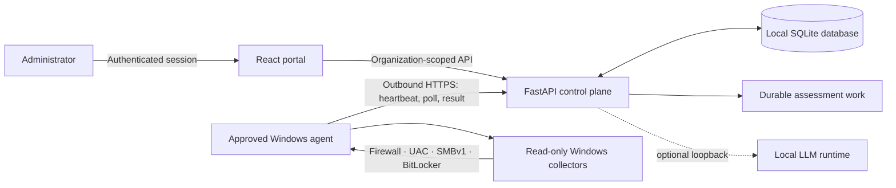
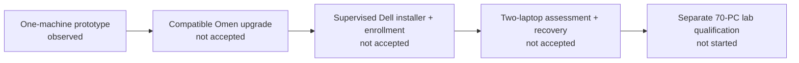

<div align="center">

# RAVEN-X

### Know what was checked. Know what was found. Know what remains unknown.

**Windows security assessment by [NorthCypher](https://northcypher.tech/)**

[](#project-status)
[](#windows-collection)
[](#technology)
[](#technology)

[Overview](#what-raven-x-does) · [Architecture](#architecture) · [Status](#project-status) · [Run locally](#development-quick-start) · [Roadmap](#deployment-roadmap)

</div>

> [!IMPORTANT]
> **This is a development source tree, not an accepted fleet installer.** The enterprise prototype has been exercised on one HP Omen. The Dell Vostro physical pilot, live server upgrade, complete agent recovery rehearsal, and approximately 70-PC college rollout have **not** passed their acceptance gates. A built Setup.exe or passing source test does not change that decision.

## At a glance

| Question | Current answer |
| :-- | :-- |
| **What is it?** | A local control plane and Windows endpoint agent for supervised, read-only security assessments, plus a separate preserved personal scanner. |
| **Who uses it?** | An administrator in a browser portal; approved agents initiate outbound HTTPS connections. |
| **Enterprise checks?** | Windows Firewall, User Account Control (UAC), SMBv1, and BitLocker. |
| **Portal views?** | Fleet, enrollment, assessments, findings, reports, activity, schedules, groups/scopes, compliance, and optional AI Analyst. |
| **Where does evidence go?** | To the configured local control plane. Optional loopback AI is disabled by default. |
| **Ready for 70 PCs?** | No. A separate physical pilot and college-lab qualification remain open. |

## What RAVEN-X does

RAVEN-X helps an operator distinguish a **confirmed finding** from **incomplete collection**. Job completion and evidence coverage are separate: an assessment may finish while a check is unavailable or fails. Findings confirmed before a later collection failure remain visible; unsupported collection never becomes a healthy result.

The current enterprise workflow:

1. An administrator issues a short-lived, single-use enrollment token.
2. A Windows agent enrolls and waits for human approval.
3. The approved agent sends heartbeats, polls for work, and submits evidence over outbound HTTPS.
4. A read-only assessment collects the four supported categories of Windows evidence.
5. The organization-scoped portal presents results, findings, coverage, compliance, and audit activity.

The original `scanner.py` personal edition remains a **separate local workflow**. Its broader historical scanner and remediation code must not be confused with the four-check enterprise agent or treated as enterprise auto-remediation.

## Project status

The preserved WS-01 baseline is commit `409f955` on `oct15-prototype`. Phase 1A-B, installer, WS-03 server-upgrade, and WS-03C recovery work followed in the development tree. Publishing a Git commit does not qualify an installed Windows release.

| Area | Implemented or observed | Remaining limit |
| :-- | :-- | :-- |
| Personal scanner | Preserved `scanner.py` local mode | Separate from enterprise behavior |
| Control plane | FastAPI services, organization scoping, React portal | Installed Omen server is older than current source; upgrade is gated |
| Endpoint lifecycle | Enrollment, manual approval, heartbeat, work polling, results, credential renewal and revocation in source | Installed Windows upgrade and recovery need physical validation |
| Assessment | Read-only Firewall, UAC, SMBv1, BitLocker collectors | More Windows editions, languages, SYSTEM execution and resource bounds need coverage |
| Finding integrity | Confirmed findings can survive failed collection while coverage remains incomplete | Phase 1A-B is a **conditional source pass** |
| Installer | Inno Setup `RAVEN-X-Agent-Setup.exe` 1.0.0-rc1 built and its payload checked | Unsigned; no supervised Dell installation passed |
| Server upgrade / recovery | Source, manifests, backups, migration and synthetic checks | Full privileged rehearsal and live transitions not accepted |
| Local AI | Optional OpenAI-compatible loopback analysis | Disabled by default; advisory only |
| College lab | Target: approximately 70 Windows PCs | No rollout or scale acceptance |

The [public release-status summary](docs/RELEASE_STATUS.md) records the acceptance boundaries. Phase 1A-B is a **conditional source pass**; WS-03C RC6e is **NO-GO** for privileged/live acceptance; the Dell–Omen pilot is **BLOCKED before installation**. Those decisions are not a fresh full-suite pass for this Git revision.

## Architecture



The backend separates business contracts (`backend/domain`), use cases (`backend/application`), adapters and persistence (`backend/infrastructure`), HTTP composition (`backend/api`), agent runtime (`backend/agent`), and typed agent protocol (`backend/protocol`). The React/TypeScript portal is in `frontend/`. Legacy personal scanner modules remain isolated from the enterprise path.

### Security model

- **Human approval:** a token creates a pending enrollment; approval is required before work.
- **Endpoint identity:** credentials bind an agent to an endpoint and organization; expired, revoked, or unapproved identities must fail authorization.
- **Windows custody:** agent state uses protected storage and DPAPI. Physical recovery has its own gates.
- **Network trust:** agent HTTPS validates CA and host identity; the installer's expected CA fingerprint must arrive independently of its bundle.
- **Tenant boundaries:** membership and ownership checks apply through API, service, and storage paths.
- **Replay resistance:** protocol and renewal flows use freshness controls. Source tests do not substitute for installed Windows validation.
- **Evidence honesty:** failed/unsupported collection is explicit; job completion does not promise complete coverage.
- **Audit trail:** security events are persisted separately from transient telemetry.

See the acceptance records for exact tested cases and limits. This summary is not a third-party certification.

## Windows collection

| Collector | Evidence | Interpretation |
| :-- | :-- | :-- |
| Firewall | Windows Firewall state and coverage | Missing or failed data is not healthy |
| UAC | User Account Control policy | Only confirmed, supported evidence becomes a finding |
| SMBv1 | Legacy protocol exposure | Incompatible collection remains explicit |
| BitLocker | Volume encryption | A confirmed problem may coexist with incomplete coverage |

Collectors are read-only. Duplicate JSON properties and invalid constants are rejected. One open resource limit remains: subprocess output is captured before its length check. The [release-status summary](docs/RELEASE_STATUS.md) tracks this limit.

## Technology

| Layer | Main technology |
| :-- | :-- |
| API | Python 3.13, FastAPI, Pydantic |
| Persistence | SQLAlchemy and local SQLite |
| Portal | React 19, TypeScript, Vite, Framer Motion |
| Windows agent | Python, PowerShell, pywin32, DPAPI, Scheduled Tasks |
| Transport | HTTPS and typed agent messages |
| Installer candidate | Inno Setup, pinned offline wheels, integrity manifests |
| Optional AI | Local OpenAI-compatible runtime; disabled unless configured |

Pins are in `requirements-server.txt`, `requirements-agent.txt`, `requirements-agent-lock.txt`, and `frontend/package.json`.

## Repository map

```text
backend/
  agent/             Windows host, collectors and credential state
  api/               FastAPI routers and composition
  application/       Enrollment, assessment, reporting and operations
  domain/            Business models and rules
  infrastructure/    Persistence, transport, security and AI adapters
  protocol/          Agent message contracts
frontend/            React portal and browser tests
scripts/             Install, release, upgrade and rehearsal tools
tests/               Backend unit and integration tests
docs/operations/      Acceptance and operating documentation
scanner.py           Preserved personal scanner entry point
```

## Development quick start

> [!CAUTION]
> Use disposable, protected local data. These commands do not install or upgrade the HP Omen or Dell. Never commit live tokens, private keys, protected database copies, or agent credentials.

The enterprise development target is **Windows AMD64 with Python 3.13** and **Node.js/npm** for the portal. Build dependencies and inspect the CLI:

```powershell
python -m venv .venv
.\.venv\Scripts\python.exe -m pip install -r requirements-server.txt
cd frontend
npm ci
npm run build
cd ..
.\.venv\Scripts\python.exe -m backend.cli --help
```

The CLI exposes `migrate`, `bootstrap`, `tls-init`, `serve`, and `rollback-check`. A disposable **loopback-only** development server can use `.\.venv\Scripts\python.exe -m backend.cli serve --data-dir <private-test-directory> --local-http` after database initialization and administrator bootstrap. Production HTTPS enforces protected Windows storage and certificate/key ownership. Use the dedicated runbooks for real machines; do not weaken checks for an ad hoc launch.

### Validation

```powershell
python -m pytest tests -q
cd frontend
npm run build
npm run test:e2e
```

Some tests require Windows privileges and private test roots. Fixture browser tests do not prove real backend authentication. Phase 1A-B recorded **895 passed, 3 skipped** on Python 3.13 and **4 passed** in the fixture browser layer. Later WS-03 and WS-03C changes have separate records; the RC6e handoff explicitly says its older full-suite result is **not** RC6e evidence. Skipped privileged cases remain unverified.

## Deployment roadmap



1. **Freeze and authenticate a release.** Review exact source and manifests; sign artifacts or convey independent trusted digests for installer and CA.
2. **Qualify the server upgrade.** Test protected backup, migration, TLS listeners, rollback and forward recovery in a disposable Windows environment before any live Omen change.
3. **Qualify agent recovery.** Complete synthetic DPAPI, SYSTEM task, archive, restore, ACL and failure-recovery checks.
4. **Run the Dell–Omen pilot.** Validate installer custody, CA pinning, enrollment, approval, heartbeats, collectors, findings, reboot, renewal and revocation on the actual Dell.
5. **Gate the 70-PC rollout separately.** Establish inventory, network/TLS stability, operator runbooks, staged scale tests, update and recovery processes.

The [release-status summary](docs/RELEASE_STATUS.md) distinguishes source readiness from physical pilot approval. Local operator runbooks contain machine-specific details and are intentionally outside this public update.

## Responsible use

Run RAVEN-X only on systems you own or are authorized to assess. This repository should contain source and reviewed documentation, **not** live databases, private TLS material, credentials, or generated installer binaries. Historical test counts and hashes belong to their matching candidate; verify revision and acceptance record before relying on them.

**License:** no open-source license is declared. Public source visibility does not grant reuse rights. Product information: [NorthCypher](https://northcypher.tech/).
